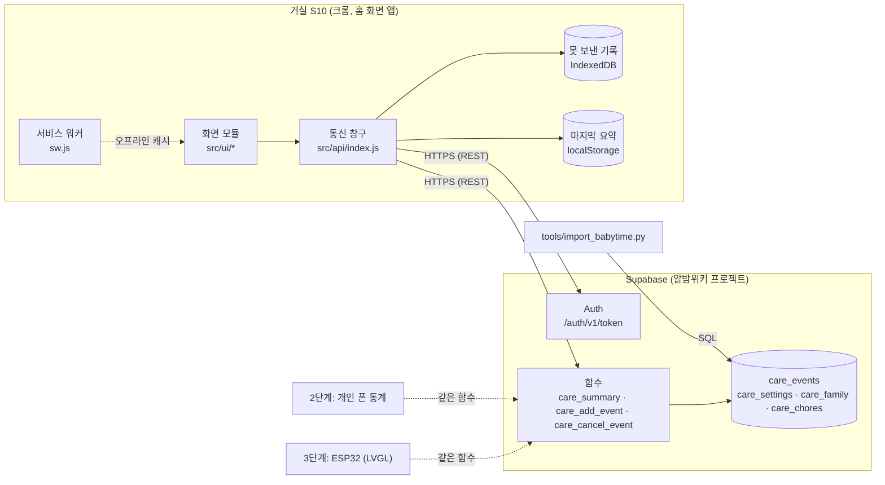
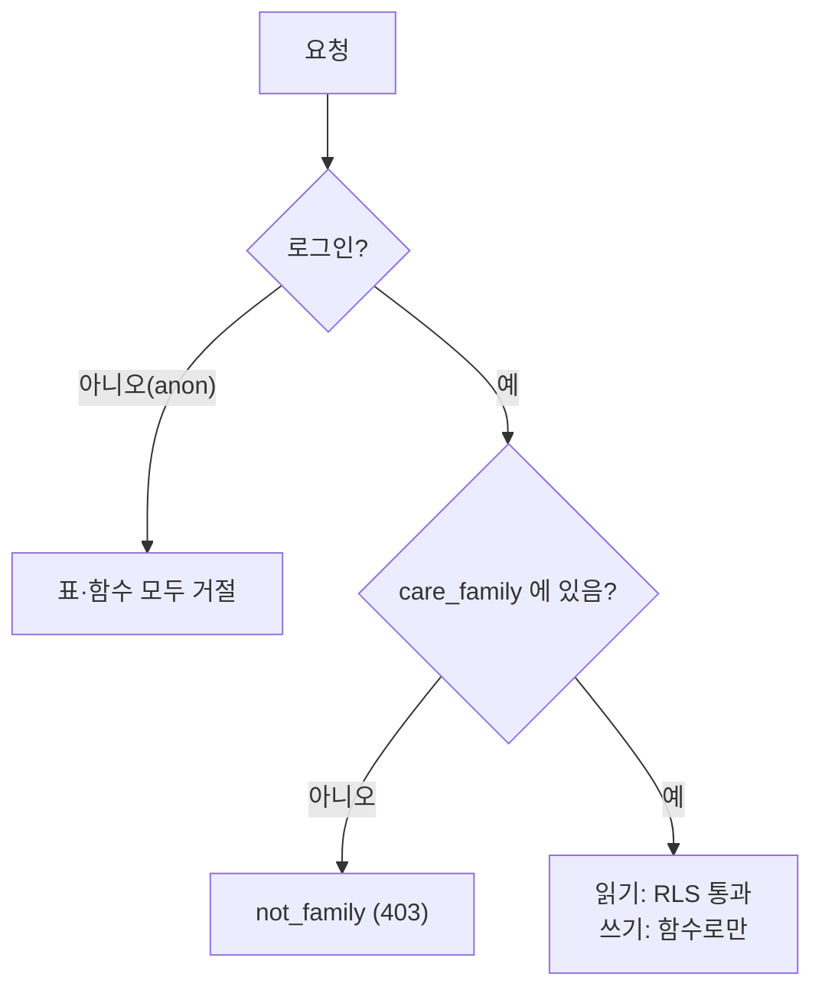
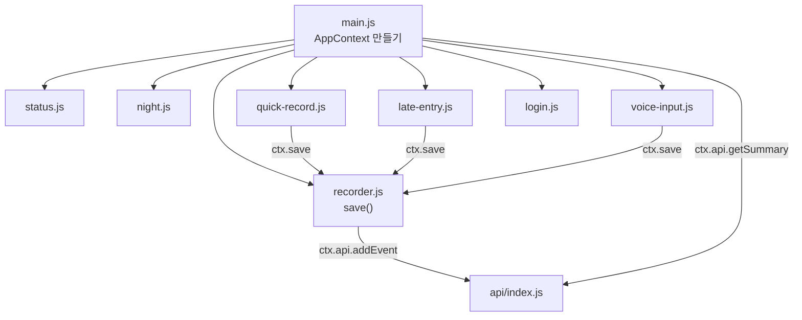
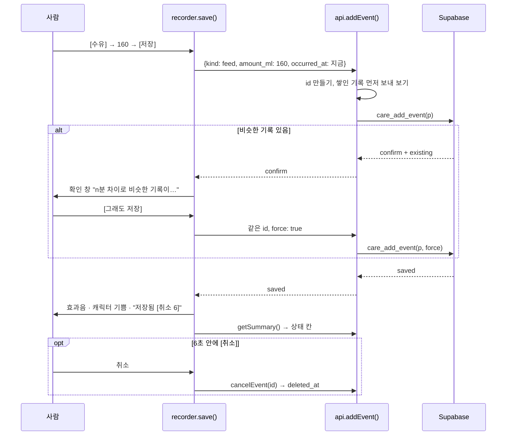
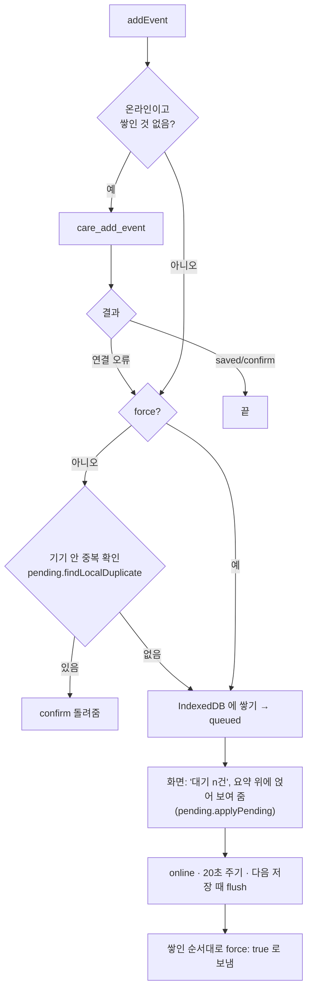
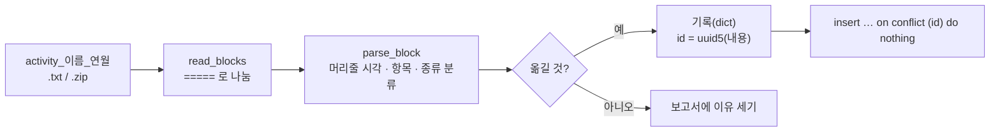

# 알밤케어 기술 문서

거실 갤럭시 S10에 띄워 두는 세훈이 기록 화면(1단계)의 설계와 코드 안내서다.
코드를 고치거나 2·3단계를 붙이는 사람이 처음 읽는 문서로 썼다. 처음 설치하는 방법은 [README](../README.md)에 있다.

- 기준 문서: 육아가정 대시보드 착수 문서 (2026-11-06)
- 대상 범위: 1단계 (수유·기저귀 기록, 상태 표시, 음성, 지난 기록, 오프라인, 번인 대비, 베이비타임 옮기기)

## 목차

1. [설계 원칙](#1-설계-원칙)
2. [전체 구조](#2-전체-구조)
3. [폴더와 파일](#3-폴더와-파일)
4. [데이터 (Supabase)](#4-데이터-supabase)
5. [화면 코드](#5-화면-코드)
6. [주요 흐름](#6-주요-흐름)
7. [음성 규칙](#7-음성-규칙)
8. [도트 화면과 번인 대비](#8-도트-화면과-번인-대비)
9. [베이비타임 옮기기](#9-베이비타임-옮기기)
10. [시험](#10-시험)
11. [배포와 버전](#11-배포와-버전)
12. [고치고 늘리는 법](#12-고치고-늘리는-법)
13. [결정 기록](#13-결정-기록)
14. [알려진 한계](#14-알려진-한계)
15. [문제 해결](#15-문제-해결)

---

## 1. 설계 원칙

착수 문서에서 정한 것을 코드 규칙으로 옮기면 다음과 같다.

| 원칙 | 코드에서 |
| --- | --- |
| 화면은 얇게, 계산은 Supabase에 | 마지막 수유·오늘 합계·최근 양은 `care_summary()`가 계산한다. 화면이 스스로 세는 건 마지막 수유 뒤 지난 시간뿐이다 |
| 통신은 두 함수 뒤에 | 화면은 `src/api/index.js`의 `getSummary()`·`addEvent()`(+`cancelEvent()`, `updateFeedAmounts()`)만 부른다. 다른 기기로 옮길 때 이 폴더만 다시 짜면 된다 |
| 실제 시각과 입력 시각을 따로 | `occurred_at`(실제)과 `recorded_at`(입력)을 따로 둔다. 정렬과 계산은 모두 `occurred_at` 기준이다 |
| 지우지 않고 취소 표시만 | 삭제 권한이 없고, 취소는 `deleted_at`만 찍는다 |
| 요약에 항목을 더하기 쉽게 | 요약은 jsonb 하나다. 키를 하나 더해도 기존 화면은 깨지지 않는다 |
| 도트 그림은 원본 PNG로 따로 | `sprites/*.png`와 칸 위치 `sprites.json`. 웹과 ESP32가 같은 파일을 쓴다 |
| 정하지 않은 값은 설정으로 | 화면 쪽은 `config.js`, 데이터 쪽은 `care_settings` 표에 둔다 |

코드는 다음 규칙을 따른다.

- **빌드 없음, 의존성 없음.** 브라우저가 ES 모듈을 그대로 읽는다. 고친 파일을 올리면 바로 반영된다.
- **한 파일에 한 가지 일.** 파일 맨 위 주석에 그 파일이 하는 일을 적는다.
- **계산은 순수 함수로 떼어 낸다.** 시각 글자, 음성 해석, 못 보낸 기록 얹기, 캐릭터 기분 같은 계산은 DOM을 모르는 함수로 둔다. 그래서 Node로 시험할 수 있다.
- **이름은 영어, 주석과 화면 글은 한국어.**
- **숫자는 이름 붙은 상수로.** 예: `MAX_DAYS_BACK = 7`.

## 2. 전체 구조



- 화면은 20초마다 `care_summary()`를 다시 부른다. 다른 기기에서 넣은 기록은 이 주기로 반영된다.
- 기록은 `care_add_event()`로만 들어간다. 표에 바로 쓰는 권한은 없다.
- 연결이 끊기면 기록을 IndexedDB에 쌓아 둔다. 다시 연결되면 들어간 순서대로 보낸다.

## 3. 폴더와 파일

```
albam/
├─ index.html              화면 뼈대(마크업만)
├─ config.js               바꾸기 쉬운 설정값 (일반 <script>, 빌드 없이 고침)
├─ manifest.webmanifest    홈 화면 앱: 전체 화면, 가로
├─ sw.js                   서비스 워커: 파일 캐시
├─ styles/app.css          모든 스타일
├─ src/
│  ├─ main.js              시작점: 모듈을 만들고 잇고, 주기 작업을 건다
│  ├─ config.js            설정 읽기(기본값 + config.js + 기기에서 넣은 연결 정보)
│  ├─ domain.js            기록·요약의 모양(JSDoc 형식), 종류 상수, 화면 이름
│  ├─ time.js              시각 → 글자 (순수 함수)
│  ├─ voice-parse.js       음성 문장 → 기록 (순수 함수)
│  ├─ api/
│  │  ├─ index.js          통신 창구 createApi(): getSummary · addEvent · cancelEvent
│  │  ├─ supabase-rest.js  로그인·토큰 갱신·함수 호출(REST)
│  │  ├─ queue.js          못 보낸 기록 IndexedDB
│  │  ├─ pending.js        못 보낸 기록을 요약에 얹기, 기기 안 중복 확인 (순수 함수)
│  │  ├─ errors.js         AuthError · NetworkError
│  │  └─ demo.js           ?demo 가짜 서버 (index.js 에 끼워 실제와 같은 흐름으로)
│  └─ ui/
│     ├─ dom.js            $, $$, el() 도움 함수
│     ├─ stage.js          정수배 확대, 번인 대비 이동, 화면 켜짐 유지
│     ├─ sheets.js         덮는 창 열기·닫기
│     ├─ sound.js          효과음(WebAudio)
│     ├─ status.js         상태 칸과 캐릭터
│     ├─ night.js          밤 화면
│     ├─ recorder.js       저장 공통 흐름: 중복 확인 창, 저장 직후 취소
│     ├─ quick-record.js   [수유] [기저귀] 버튼과 창
│     ├─ feed-amounts.js   수유량 설정(빠른 선택 세 개)
│     ├─ late-entry.js     지난 기록 넣기, 최근 기록
│     ├─ voice-input.js    음성 입력
│     └─ login.js          로그인 창
├─ supabase/
│  ├─ 001_care_schema.sql   표·권한·함수 (여러 번 실행해도 안전)
│  └─ 002_feed_amounts.sql  수유량 빠른 선택을 직접 정하기
├─ sprites/                도트 그림 원본 PNG + sprites.json
├─ fonts/                  갈무리 글꼴 (SIL OFL 1.1)
├─ tools/
│  ├─ make_sprites.py      도트 그림 만들기
│  └─ import_babytime.py   베이비타임 내보내기 → SQL
└─ tests/
   ├─ unit/                Node 시험 (순수 함수, 서비스 워커 목록)
   ├─ tools/               Python 시험 (베이비타임 가져오기)
   ├─ sql/                 임시 Postgres로 SQL 시험
   └─ e2e/                 Playwright 브라우저 시험 (S10 크기)
```

모듈은 위에서 아래로만 가져다 쓴다(`ui → api → domain/time`). `api`는 `ui`를 모른다.

## 4. 데이터 (Supabase)

### 4.1 표

모든 이름은 `care_`로 시작한다. 알밤위키의 기존 표와 겹치지 않게 하려는 것이다.

**care_events**: 기록

| 열 | 형식 | 설명 |
| --- | --- | --- |
| id | uuid | 화면이 만들어 보낸다. 다시 보내도 한 번만 들어가게 하는 열쇠 |
| kind | text | `feed`, `diaper`, `sleep`, `chore_done`. 소문자 영어와 `_`만 쓴다(검사 있음) |
| occurred_at | timestamptz | 실제 시각. 모든 정렬·계산의 기준 |
| ended_at | timestamptz, null | 수면 끝. `occurred_at`보다 앞설 수 없다 |
| recorded_at | timestamptz | 입력 시각, 기본값 `now()` |
| amount_ml | int, null | 수유량. 0~1000 |
| detail | jsonb | 종류별 세부. 기저귀는 `{"type": "pee"\|"poo"\|"both"}` |
| chore_id | uuid, null | `care_chores` 참조 (2단계) |
| source | text | `living_room_touch`, `living_room_voice`, `phone`, `import` |
| recorded_by | uuid, null | 넣은 사람(`auth.uid()`). 화면에는 띄우지 않는다 |
| voice_text | text, null | 음성 원문 |
| deleted_at | timestamptz, null | 취소 표시 |

색인은 `(kind, occurred_at desc)`와 `(occurred_at desc)` 두 개다. 둘 다 취소되지 않은 기록만 담는다.

**care_family**: 기록을 읽고 쓸 수 있는 계정. `user_id → auth.users`

**care_settings**: 설정값(key → jsonb)

| key | 기본 | 뜻 |
| --- | --- | --- |
| day_start_hour | 0 | 하루를 끊는 시각(서울). 0이면 자정 |
| dup_window_minutes | 10 | 같은 종류가 이 시간(분) 안에 있으면 확인을 묻는다 |
| feed_amounts | [180, 200, 220] | 수유량 빠른 선택(ml). 화면의 '수유량 설정'에서 바꾼다(002) |
| recent_limit | 8 | 요약의 최근 기록 개수 |

**care_chores**: 집안일 규칙(2단계). 지금은 표만 있다.

### 4.2 권한



- `anon`은 표와 함수에 아무 권한이 없다.
- `authenticated`는 표를 `select`만 할 수 있다. RLS 정책이 `care_is_family()`로 가족만 통과시킨다.
- 쓰기는 `security definer` 함수 세 개로만 한다. 각 함수는 맨 처음 가족인지 확인한다. 그래서 중복 확인 같은 규칙을 우회할 수 없다.
- 함수는 모두 `set search_path = ''`로 고정했다(Supabase 권장). 그래서 안의 이름은 모두 `public.` 접두사를 붙여 적는다.

### 4.3 함수 계약

**`care_summary() → jsonb`**: 화면이 읽는 유일한 것

```json
{
  "server_time": "2026-11-06T05:00:00Z",
  "day_start": "2026-11-05T15:00:00Z",
  "last_feed":   { "id": "…", "at": "…", "ml": 160 },
  "today":       { "feed_count": 6, "feed_ml": 820 },
  "last_diaper": { "id": "…", "at": "…", "type": "poo" },
  "last_sleep":  { "id": "…", "at": "…", "ended_at": "…" },
  "feed_amounts": [180, 200, 220],
  "recent": [ { "id": "…", "kind": "feed", "at": "…", "ended_at": null, "ml": 160, "detail": {}, "source": "…" } ],
  "due_chores": [],
  "settings": { "day_start_hour": 0, "dup_window_minutes": 10 }
}
```

- `last_*`는 기록이 없으면 `null`이다.
- `today`는 `day_start`부터 24시간 안의 수유만 센다.
- `feed_amounts`는 `care_settings.feed_amounts`(작은 것부터)다.
- `recent`는 실제 시각 역순이다.
- `due_chores`는 2단계에서 채운다.

**`care_add_event(p jsonb) → jsonb`**

| 입력 키 | 필수 | 설명 |
| --- | --- | --- |
| id | | 없으면 서버가 만든다. 화면은 항상 보낸다 |
| kind | ✓ | |
| occurred_at | | 없으면 지금. 5분 넘는 미래는 거절한다 |
| ended_at, amount_ml, detail, source, voice_text, chore_id | | |
| force | | `true`면 중복 확인을 건너뛴다 |

| 결과 | 뜻 |
| --- | --- |
| `{"status":"saved","id":…}` | 저장됨 |
| `{"status":"saved","id":…,"repeat":true}` | 이미 받은 id. 다시 보낸 것이므로 성공으로 본다 |
| `{"status":"confirm","existing":{id,kind,at,ml,detail}}` | ±`dup_window_minutes` 안에 같은 종류가 있다. 저장하지 않았다 |
| 오류 `22023` | `bad_kind`, `occurred_at_in_future`, `bad_amount`, `bad_diaper_type`, `ended_before_started` |
| 오류 `42501` | `not_family` |

**`care_cancel_event(p_id uuid) → jsonb`**: `cancelled` / `already_cancelled` / `not_found`

**`care_set_feed_amounts(p_amounts int[]) → jsonb`** (002): 수유량 빠른 선택 저장. 1~6개, 각 10~500ml. 같은 양은 하나로 합치고 작은 것부터 둔다.
결과 `{"status":"saved","feed_amounts":[…]}`, 범위를 벗어나면 오류 `22023 bad_feed_amounts`.

### 4.4 시간대

계산은 모두 `Asia/Seoul` 기준이다. 저장은 `timestamptz`(UTC)로 한다. 하루의 시작은 다음 식으로 구한다.

```
(서울 지금 − day_start_hour 시간)의 날짜 + day_start_hour 시간
```

## 5. 화면 코드

### 5.1 모듈 관계



화면 모듈은 서로를 직접 가져다 쓰지 않는다. 대신 `main.js`가 만든 **AppContext(`ctx`)**를 받아, 그것을 통해서만 서로를 부른다.

| ctx 항목 | 하는 일 |
| --- | --- |
| `cfg` | 설정값 |
| `api` | 통신 창구. 로그인 창에서 Supabase 주소를 바꾸면 새것으로 갈린다. 그래서 늘 `ctx.api`로 부른다 |
| `state` | 화면 상태 (아래 표) |
| `sfx` | 효과음 `save/cancel/error/listen/tap` |
| `now()` | 서버 시각에 맞춘 지금 |
| `isNightTime()`, `isNightAwake()`, `isBusy()` | 밤 시간대인지, 밤에 터치해서 밝혀 둔 동안인지, 창·음성·취소 버튼이 떠 있는지 |
| `render()`, `tick()` | 상태 칸 전체를 다시 그림 / 시계·캐릭터·밤 화면만 다시 그림 |
| `refresh()` | 요약 다시 받기 |
| `say(text, 초, tone)` | 말풍선에 잠깐 띄우기 |
| `save(ev, {force})` | 기록 저장(공통 흐름) |
| `showLogin(msg)`, `reconnect()` | 로그인 창 열기 / 통신 새로 만들기 |

**state**

| 항목 | 설명 |
| --- | --- |
| summary | 화면에 보이는 요약(못 보낸 기록까지 얹은 것) |
| stale | 서버에서 못 받고 마지막 요약을 보여 주는 중 |
| pending | 못 보낸 기록 수 → "대기 n건" |
| clockSkewMs | 서버 시각 − 기기 시각. 5초 안쪽이면 0 |
| happyUntil | 저장 직후 캐릭터 기쁨이 끝나는 시각 |
| bubble | 말풍선 `{text, until, tone}` |
| nightWakeUntil | 밤에 터치해서 밝혀 둔 끝 시각 |
| lastTouchAt, startedAt | 하루 한 번 새로 고칠지 정할 때 쓴다 |
| authProblem | 가족 계정이 아닐 때 띄울 말 |

### 5.2 주기 작업 (`main.js`)

| 주기 | 일 |
| --- | --- |
| 0.6초 | 캐릭터 프레임 바꾸기, 지금 시각·지난 시간, 밤 화면 |
| 20초 (`pollSeconds`) | 요약 다시 받기(화면이 보일 때만) |
| 3분 (`shiftMinutes`) | 화면 전체를 1~2 논리 픽셀 옮기기 |
| 1분 | 화면 켜짐 다시 잡기, 하루 한 번 새로 고칠지 보기 |
| `online` 이벤트 | 못 보낸 기록 보내기 → 요약 |
| 화면이 다시 보일 때 | 요약 받기, 화면 켜짐 다시 잡기 |

### 5.3 캐릭터 기분 (`status.js` `chooseMood`)

| 우선 | 기분 | 조건 |
| --- | --- | --- |
| 1 | 기쁨 | 저장하고 3초 안 |
| 2 | 잠 | 밤이고 화면이 어두운 상태 |
| 3 | 배고픔 | 마지막 수유 뒤 `hungryMinutes`(180분)가 지남. 큰 글씨(지난 시간)도 주황색으로 바뀐다 |
| 4 | 잠 | 밤(터치해서 밝힌 동안) |
| 5 | 평소 | |

스프라이트 줄 순서는 `sprites.json`과 `status.js`의 `MOOD_ROW`가 같아야 한다.

### 5.4 시각 표기 규칙

시각이 여럿 보이므로, 숫자만 두지 않고 **무엇의 시각인지 글로 붙인다**(흐린 이름표 + 값).

| 줄 | 예 | 규칙 |
| --- | --- | --- |
| 맨 위 왼쪽 | 마지막 수유 11:25 · 160ml | 시계 시각은 "마지막 ○○" 뒤에만 쓴다 |
| 맨 위 오른쪽 | 지금 14:00 | 현재 시각은 늘 "지금" |
| 큰 글씨 | **2**시간 **35**분 전 | 마지막 수유 뒤 지난 시간. 숫자 48, 단위 24. 10시간 넘으면 숫자를 36으로 |
| 셋째 줄 | 오늘 수유 3회 · 420ml | |
| 넷째 줄 | 마지막 기저귀 소변 · 1시간 10분 전 | 줄이 좁아 10시간 넘으면 "11시간 전"처럼 분을 뺀다 |
| 밤 화면 | 2시간 35분 전 / 마지막 수유 20:55 · 지금 23:30 | |

- 지난 시간은 "n시간 m분 전"으로 쓴다. "2:35"처럼 시계 시각과 헷갈리는 꼴은 쓰지 않는다. 1분이 안 되면 "방금", 분이 0이면 "2시간 전"이다.
- 지난 시간은 `time.js`의 `agoParts()`·`formatAgo()` 한 곳에서 만든다.
- 상태 칸 글이 칸을 넘지 않는지는 브라우저 시험이 가장 긴 경우(12시간 넘음, 소변+대변)로 확인한다.

## 6. 주요 흐름

### 6.1 저장



같은 `id`를 다시 쓰므로, 확인 뒤 저장이나 다시 보내기가 두 줄을 만들지 않는다.

### 6.2 연결이 끊겼을 때



- **순서를 지킨다.** 쌓인 기록이 있으면 새 기록도 그 뒤에 쌓는다. 같은 기록의 "추가"가 "취소"보다 먼저 가야 하기 때문이다.
- **쌓인 기록은 `force: true`로 보낸다.** 기기 안에서 이미 확인을 거쳤거나, 확인할 수 없던 기록이기 때문이다.
- **아직 못 보낸 기록을 취소하면** 큐에서 빼기만 한다. 서버에는 아무것도 가지 않는다.
- **서버가 형식 오류로 거절한 기록은 버린다.** 큐가 계속 막히지 않게 하려는 것이다. 버릴 때 콘솔에 남긴다.
- **오프라인 요약은 근사치다.** 마지막으로 받은 요약 위에 못 보낸 기록을 얹을 뿐이다. 연결되면 서버 값으로 바뀐다.
- **수유량 설정도 같은 큐를 탄다.** 연결이 끊긴 채 바꾸면 `op: 'feed_amounts'`로 쌓이고, 그동안 화면은 새 양을 쓴다(`applyPending`).
- **미리 보기(?demo)도 같은 코드를 탄다.** `createApi()`에 Supabase 대신 `demo.js`의 `DemoServer`를 끼운 것이라, 기기가 오프라인이면 똑같이 쌓이고 "대기 n건"이 뜬다. 기기 안 이름은 따로 쓴다(`STORAGE.demo`: 큐 `albam-demo`, 캐시 `albam.demo.summary`). 미리 보기 기록이 실제 Supabase 로 갈 일은 없다.

### 6.3 로그인과 토큰

- 로그인은 `POST /auth/v1/token?grant_type=password`로 한다. 받은 토큰은 `localStorage['albam.session']`에 둔다.
- 만료 2분 전에 미리 갱신한다(`grant_type=refresh_token`). 401을 받으면 한 번 갱신한 뒤 다시 보낸다.
- 갱신 토큰은 한 번 쓰면 바뀐다. 그래서 동시에 두 번 갱신하지 않도록 진행 중인 요청을 하나만 둔다.
- 갱신이 연결 문제로 실패하면 로그인을 유지한다. 토큰이 무효라서 실패하면 로그아웃하고 로그인 창을 띄운다.

### 6.4 시계 보정

요약의 `server_time`과 받은 시각의 차이가 5초를 넘으면, 경과 시간을 서버 시각 기준으로 센다(`ctx.now()`). 기기 시계가 틀려도 "2시간 35분 전"이 맞게 나온다.

## 7. 음성 규칙

`src/voice-parse.js`는 다음 순서로 문장을 기록으로 바꾼다.

1. **정규화** `normalize()`
   - "밀리·미리·씨씨·cc" → `ml`
   - 고유어 시각("한 시", "두시간") → 숫자
   - 띄어 말한 한자어 수사 붙이기("백 육십" → "백육십"). 뒤 덩어리에 시·분이 붙으면 다른 숫자로 보고 붙이지 않는다("이백 이십 분 전").
   - 한자어 수사 → 숫자. 십·백·천이 들어 있거나 바로 뒤에 단위가 올 때만 바꾼다. 그래야 "오후"의 "오" 같은 낱말을 건드리지 않는다.
   - "반" → 30분
2. **종류 고르기**: 잠 → 기저귀 → 수유 순서로 시도한다(`WORDS`).
3. **시각**
   - "n분 전", "n시간 m분 전"
   - "(오전/오후/새벽/밤) h시 m분(에)". 오전·오후를 말하지 않으면 지금 이전에서 가장 가까운 쪽을 고른다.
   - 수면은 "h시 m분부터 h시 m분까지"로 말한다. 끝을 먼저 정하고, 시작은 끝 이전에서 고른다. 16시간을 넘으면 잘못 알아들은 것으로 본다.

| 말 | 결과 |
| --- | --- |
| 수유 160 / 160 먹였어 / 분유 백육십 | 수유 160ml, 지금 |
| 수유 160 20분 전 / 수유 백육십 이십 분 전 | 20분 전 |
| 수유 120 1시간 반 전 | 90분 전 |
| 수유 140 2시 10분에 | 가장 가까운 과거의 2:10(14:10 또는 02:10) |
| 기저귀 대변 / 응가 / 소변 / 쉬 / 둘 다 / 소변 대변 | 기저귀 |
| 잠 1시 10분부터 2시 40분까지 / 밤잠 밤 9시부터 새벽 3시까지 | 수면 |

규칙으로 못 알아들은 문장은 기록하지 않는다. 원문을 보여 주고 다시 말해 달라고 한다.
크롬은 인식 후보를 최대 5개 돌려준다. 그중 규칙에 맞는 첫 번째를 쓴다.

## 8. 도트 화면과 번인 대비

- **논리 해상도 380×180.** S10의 FHD+(2280×1080)에서는 6배, WQHD+(3040×1440)에서는 8배로 딱 나눠떨어진다.
  - `stage.js`가 `floor(min(기기 가로/380, 기기 세로/180))`배를 고르고 CSS `zoom = 배수 / devicePixelRatio`로 키운다.
  - 화면의 왼쪽 위 모서리도 기기 화소에 맞춘다.
- **CSS의 px는 모두 논리 픽셀이다.** 글자 크기는 갈무리11의 정수배(12·24·36·48)만 쓴다. 작은 글은 갈무리9(10px)다. 그림은 `image-rendering: pixelated`로 그린다.
- **좌우 16 논리 픽셀은 비운다.** 곡면 가장자리라 버튼과 글자를 두지 않는다.
- **번인 대비**
  - 바탕은 거의 검정이고 밝고 넓은 면을 두지 않는다. 버튼은 테두리만 밝다.
  - 3분마다 `#shift`를 1~2 논리 픽셀씩 옮긴다(13자리를 돈다).
  - 밤(21~6시)에는 `#night`가 덮는다. 아주 어두운 글자(마지막 수유 뒤 지난 시간·지금 시각)만 보이고, 그 자리는 1분마다 바뀐다.
  - 밤에 터치하면 30초 동안 원래 화면을 어둡게(`brightness .55`) 보여 준다.
- **화면 켜짐**: Screen Wake Lock. 다른 앱에 다녀오면 풀리므로 다시 보일 때, 터치할 때, 1분마다 다시 잡는다.
- **24시간 운영**: 새벽 4시대에 한 번 새로 고친다. 단, 3시간 넘게 켜져 있었고, 2분 동안 아무도 만지지 않았고, 열린 창이 없을 때만 한다.

### 도트 그림

`tools/make_sprites.py`가 그림을 코드로 그린다.

- 밤톨 몸통: 타원과 꼭지점의 볼록 껍질
- 얼굴: 문자 그림

결과는 다음 파일이다.

| 파일 | 내용 |
| --- | --- |
| `sprites/albam.png` | 32×32 칸. 4줄(평소·배고픔·잠·기쁨) × 2칸(애니메이션) |
| `sprites/icons.png` | 12×12 아이콘 |
| `sprites/sprites.json` | 칸 위치 |
| `icon-*.png` | 홈 화면 아이콘 |

그림을 바꾸려면 이 스크립트를 고치고 `npm run sprites`를 돌린다.

## 9. 베이비타임 옮기기

`tools/import_babytime.py`



- 시각은 `YYYY-MM-DD hh:mm AM/PM`, `오전/오후`, 24시간 표기를 모두 읽고 서울 시각으로 둔다.
- 종류는 `TYPE_MAP`으로 바꾼다. 엄마 유축·투약·이유식 등(`SKIP_TYPES`)은 옮기지 않고 개수만 센다.
- 양 칸 이름과 값의 단위가 다르면(`Amount(ml): 5 (fl_oz)`) 값 쪽 단위를 믿는다. 온스는 ml로 바꾼다.
- 수면에 끝 시각이 없으면 `Duration`으로 끝을 계산한다.
- id는 기록 내용으로 만든 uuid5다. 같은 파일을 다시 넣어도 한 번만 들어간다.
- `--until`로 거실 화면을 쓰기 시작한 날 전까지만 옮긴다.
- 한국어로 내보낸 파일의 항목 이름은 아직 짐작이다. 실행이 끝나면 "모르는 종류/항목"을 보고하니, 그것을 보고 `TYPE_MAP`과 `*_KEYS`를 맞춘다.

## 10. 시험

| 명령 | 무엇 | 필요한 것 |
| --- | --- | --- |
| `npm test` | 음성 규칙, 시각 글자, 기록 이름, 캐릭터 기분, 수유량 선택, 못 보낸 기록 얹기, 서비스 워커 목록, 베이비타임 가져오기 | Node 22+, Python 3.9+ |
| `npm run test:sql` | 임시 Postgres를 띄워 `supabase/*.sql`을 번호 순서로 두 번 실행하고 시험한다. 권한, 중복 확인, 다시 보내기, 취소, 순서, 하루 끊는 시각 | PostgreSQL 14+ |
| `npm run test:e2e` | S10 크기 브라우저로 미리 보기, 밤 화면, 가짜 Supabase(로그인·오프라인·다시 보내기·토큰 갱신)를 눌러 본다 | Playwright + 크로미움 |

`SCREENSHOTS=/tmp/shots npm run test:e2e`로 돌리면 화면 사진도 남긴다.

**언제 무엇을 돌리나**

| 고친 곳 | 돌릴 시험 |
| --- | --- |
| `src/` | `npm test` |
| SQL | `npm run test:sql` |
| 화면 흐름이나 CSS | `npm run test:e2e`(사진 확인) |
| 파일 추가 | `sw.js` 목록에 넣는다. 빠뜨리면 `npm test`가 알려 준다 |

시험으로 확인할 수 없는 것은 실기에서 본다: 음성 인식, 마이크 권한 유지, Wake Lock, 24시간 운영, 실제 곡면 가장자리.

## 11. 배포와 버전

- 이 저장소는 GitHub Pages로 나간다. main에 합치면 `https://rosewein.github.io/albam/`에 반영된다.
- 서비스 워커는 네트워크를 먼저 쓴다. 그래서 고친 파일은 다음에 열 때 바로 보인다. 오프라인일 때만 캐시를 쓴다.
- 파일을 더하거나 이름을 바꾸면 `sw.js`의 `FILES`에 반영하고 `VERSION`을 올린다.
- SQL은 Supabase SQL Editor에서 번호 순서대로 직접 실행한다(지금 `001`, `002`). 바꿀 때는 `003_…sql`처럼 번호를 붙여 새 파일로 더하고, 이미 실행한 파일은 고치지 않는다. 함수를 바꿀 때는 새 파일에 `create or replace`로 함수 전체를 다시 쓴다(002의 `care_summary()`처럼).
- `config.js`에는 anon key만 둔다. service_role 키는 절대 넣지 않는다.

## 12. 고치고 늘리는 법

### 새 기록 종류 추가 (예: 이유식 `solid`)

1. **SQL**: `kind`는 검사만 통과하면 그대로 들어간다. 계산이 필요하면 `care_summary()`에 키를 더한다(예: `last_solid`). 종류별 검사가 필요하면 `care_add_event()`에 더한다.
2. **domain.js**: `KIND`에 `SOLID`를 더하고 `describeEvent`·`describeRecent`에 이름을 넣는다.
3. **화면**
   - 버튼이 필요하면 `index.html`에 버튼과 창을 넣는다.
   - `quick-record.js`처럼 `setupXxx(ctx)` 모듈을 만들어 `main.js`에서 부른다.
   - 지난 기록에서도 넣으려면 `late-entry.js`의 `detailControls()`와 `toEvent()`를 고친다.
4. **음성**: `voice-parse.js`의 `WORDS`에 낱말을 더하고, `parseSolid()`를 만들어 `parseUtterance()`에 넣는다.
5. **오프라인 근사**: 요약에 키를 더했다면 `api/pending.js`의 `applyPending()`에도 반영한다.
6. **시험**: 각 시험 파일에 사례를 더하고, `sw.js` 목록도 갱신한다.

### 요약에 항목 더하기

`care_summary()`의 `jsonb_build_object`에 키를 더한다. 화면은 모르는 키를 무시하므로 순서는 상관없다.
`domain.js`의 `Summary` 형식 주석도 같이 고친다.

### 설정값 더하기

| 어느 쪽 값인가 | 넣는 곳 |
| --- | --- |
| 화면 쪽 | `config.js`와 `src/config.js`의 `DEFAULTS` |
| 데이터 쪽 | `care_settings`에 행을 넣고, 함수에서 `care_setting_int()`로 읽는다. 화면도 알아야 하면 요약의 `settings`에 더한다 |

### 음성 말투 더하기

`tests/unit/voice-parse.test.mjs`의 `cases`에 문장을 먼저 넣고 실패하는 걸 본다. 그다음 `WORDS`나 `normalize()`를 고친다.

### 2단계

- **집안일**
  - `care_chores`에 규칙을 넣는다.
  - `care_summary()`에서 `due_chores`를 계산한다(수유 n회마다, 요일, 매일).
  - 화면의 "지난 기록 넣기" 줄 자리(`#lateBtn`, 오른쪽 가운데)를 할 일 칸으로 바꾼다. 완료는 `addEvent({kind: 'chore_done', chore_id})`로 넣는다.
- **개인 폰 통계(세로, 읽기 전용)**: 같은 `src/api/`를 쓰는 새 페이지를 만든다. 통계가 필요하면 `care_stats(from, to)` 같은 읽기 함수를 SQL에 더한다.
- **밤 요약**: Supabase Edge Function과 cron으로 만들고, 같은 요약 함수를 쓴다.
- **자유 문장 음성 해석**: `voice-input.js`의 `understand()`에서 규칙이 실패했을 때만 서버 함수(Claude API)를 부르게 한다. 확인 화면은 그대로 둔다.

### 3단계: ESP32(LVGL)로 옮기기

- 통신
  - HTTPS POST 세 가지를 그대로 따라 한다: 로그인, `rpc/care_summary`, `rpc/care_add_event`.
  - 헤더는 `apikey`와 `Authorization: Bearer`.
- 그림: `sprites/*.png`와 `sprites.json`의 칸 위치를 LVGL 이미지로 바꿔 쓴다. 논리 해상도 380×180은 320×240 같은 화면에 맞게 다시 배치한다.
- 오프라인 큐: `api/index.js`의 규칙을 따른다. 순서대로 `force`로 보내고, 같은 id를 다시 보내도 된다.

## 13. 결정 기록

| 결정 | 이유 | 다르게 할 때 |
| --- | --- | --- |
| supabase-js 대신 fetch로 REST 호출 | 의존성과 오프라인 캐시 파일이 줄어든다. ESP32에서 같은 HTTP를 따라 하기 쉽다 | Realtime 구독이 꼭 필요해지면 라이브러리를 들인다 |
| Realtime 대신 20초 주기 읽기 | 기준이 "1분 안 반영"이라 충분하다. 웹소켓 재연결 처리가 필요 없다 | 주기를 줄이거나 Realtime 사용 |
| 쓰기는 함수로만 | 중복 확인·검사를 모든 기기에 똑같이 적용하고, 우회할 수 없게 하려는 것이다 | |
| id를 화면이 만듦 | 오프라인으로 다시 보내도 한 번만 들어간다. 확인 뒤 저장도 같은 id를 쓴다 | |
| 모든 이름에 `care_` | 알밤위키 기존 표를 아직 보지 못했다. 겹치지 않게 하려는 것이다 | 표를 확인한 뒤 바꿔도 된다(SQL과 api 이름만 바꾸면 됨) |
| 380×180 논리 해상도 | S10의 두 해상도 모두 정수배가 되고 비율 19:9도 맞는다 | 다른 기기면 `LOGICAL`과 CSS 배치를 다시 잡는다 |
| 빌드 없는 ES 모듈 | 빌드 도구가 없어 유지할 것이 적다. GitHub Pages에 그대로 올린다 | 파일이 많아져 첫 로딩이 느려지면 번들러를 들인다 |
| 자정 대신 설정으로 하루 끊기 | 밤중 수유가 날짜를 넘나든다. 임시값은 자정이다 | `day_start_hour` |
| 밤에 화면을 끄지 않고 거의 검게 | 앱이 살아 있어야 터치·음성을 바로 받는다 | |

## 14. 알려진 한계

- **오프라인에서 두 기기가 같은 수유를 넣으면 둘 다 들어간다.** 쌓인 기록은 `force`로 보내기 때문이다. 연결된 상태라면 확인을 묻는다.
- **오프라인 요약은 근사치다.** 마지막 요약 이후 다른 기기가 넣은 기록은 연결돼야 보인다.
- **"인터넷은 되는 척하는데 안 되는" Wi-Fi에서는** 저장이 10초(시간 초과) 늦게 끝난 뒤 쌓인다.
- **음성 인식은 크롬이 서버로 보내 처리한다.** 그래서 오프라인에서는 안 된다.
- **베이비타임 한국어 내보내기 형식은 짐작이다.** 실제 파일로 맞춰야 한다.
- **취소는 저장 직후 몇 초 동안만 할 수 있다.** 그 뒤에 고치려면 SQL에서 `deleted_at`을 찍는다. 화면에서 고치는 기능은 2단계 후보다.

## 15. 문제 해결

| 증상 | 볼 곳 |
| --- | --- |
| 로그인하자마자 말풍선에 "가족 계정이 아니에요" | `care_family`에 그 사용자 id가 있는지 본다 |
| 계속 "연결 안 됨" | Supabase 프로젝트가 일시정지됐는지, `config.js`의 주소를 본다. 개발자 도구 Network에서 `rpc/care_summary` 응답도 본다 |
| "대기 n건"이 줄지 않음 | 로그인이 풀렸는지 본다(풀렸으면 로그인 창이 뜬다). 서버가 거절한 기록은 콘솔에 `dropped`로 남는다 |
| 고친 화면이 안 보임 | 한 번 새로 고친다. 그래도 안 되면 `sw.js`의 `VERSION`을 올렸는지 본다 |
| 글자나 그림이 흐림 | 기기 해상도가 380×180의 정수배가 아닌 경우다. 개발자 도구에서 `#stage`의 zoom을 본다 |
| 마이크가 안 됨 | 크롬 사이트 설정에서 마이크를 허용한다. 홈 화면 앱에서도 권한이 유지되는지 본다 |
| 화면이 꺼짐 | 크롬이 Wake Lock을 지원하는지, 절전 모드가 켜져 있는지 본다 |
| 하루 합계가 이상함 | `care_settings.day_start_hour`와 서버 시간대 계산(4.4)을 본다 |
